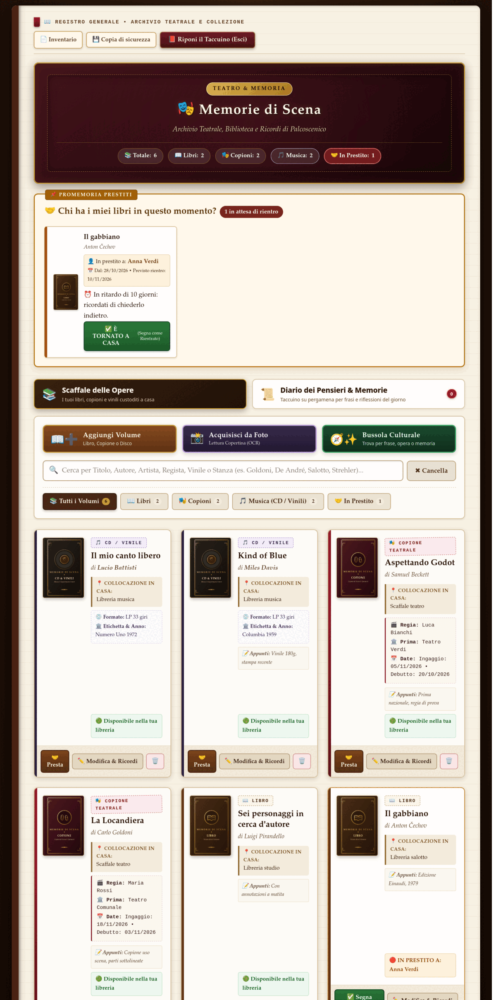
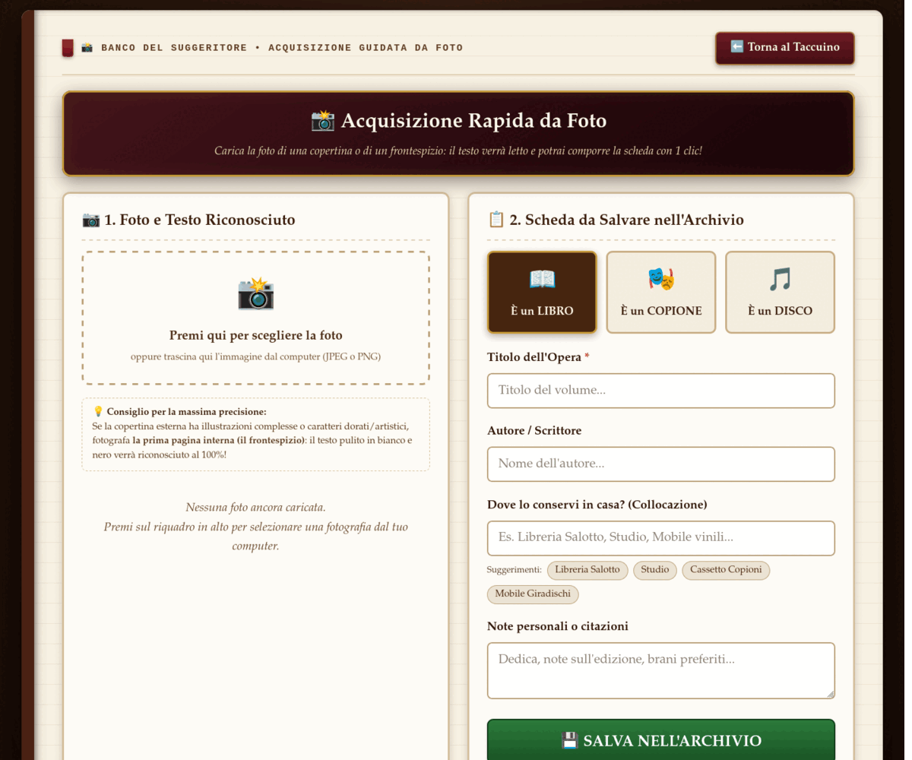

# 🎭 Memorie di Scena

### *Il taccuino digitale di casa: libri, copioni, dischi, prestiti e pensieri del giorno — semplice, privato, senza complicazioni.*

[-1b4332.svg)](#-requisiti-di-sistema)
[](#-requisiti-di-sistema)
[-40916c.svg)](#-dove-sono-i-tuoi-dati)
[](#-solo-software-libero)
[](#-verifiche-e-test)
[](VERSION)
[](LICENSE)

**In breve** — *Memorie di Scena* è un **gestionale di biblioteca personale** e un **catalogo di copioni teatrali e dischi** che funziona interamente **offline** sul tuo computer, con **Flask** e **SQLite**: cataloga libri, vinili e CD, registra i **prestiti**, conserva un **diario di citazioni** e legge le copertine dalle **foto (OCR)**. È **open source**, gratuito e senza account; i dati non lasciano mai il tuo PC.

---

## 📑 Indice

1. [Che cos'è, in due parole](#-che-cosè-in-due-parole)
2. [A chi è pensato](#-a-chi-è-pensato)
3. [Come appare](#-come-appare)
4. [Cosa puoi fare](#-cosa-puoi-fare)
5. [La Bussola Culturale: ritrovare una citazione](#-la-bussola-culturale-ritrovare-una-citazione)
6. [Novità di questa versione](#-novità-di-questa-versione)
7. [Scaricare e installare](#-scaricare-e-installare-passo-per-passo)
8. [L'uso di ogni giorno](#-luso-di-ogni-giorno)
9. [Dove sono i tuoi dati](#-dove-sono-i-tuoi-dati)
10. [Riservatezza e sicurezza](#-riservatezza-e-sicurezza)
11. [Requisiti e solo software libero](#-requisiti-di-sistema)
12. [Struttura del progetto](#-struttura-del-progetto)
13. [Verifiche e test](#-verifiche-e-test)
14. [Se qualcosa non funziona](#-se-qualcosa-non-funziona)
15. [Aggiornare senza perdere nulla](#-aggiornare-senza-perdere-nulla)
16. [Come aiutare il progetto](#-come-aiutare-il-progetto)
17. [Licenza](#-licenza)

---

## 🕯️ Che cos'è, in due parole

Molti programmi per catalogare libri sono pensati per biblioteche, con schermate piene di sigle e finestre da imparare. **Memorie di Scena** fa l'opposto: è un archivio di casa piccolo, calmo e chiaro, pensato come un taccuino teatrale d'altri tempi.

Ha due grandi registri:

- **📚 Lo Scaffale delle Opere** — i tuoi libri, i copioni di teatro e i dischi (CD e vinili), con la loro posizione in casa, le note e la copertina.
- **📜 Il Diario dei Pensieri & Memorie** — fogli dall'aspetto di pergamena, dove annotare riflessioni, battute amate, citazioni e ricordi.

Attorno a questi due registri ci sono tre aiuti concreti:

- **🤝 Il registro dei prestiti**, per sapere sempre chi ha in mano un tuo libro o copione.
- **🧭 La Bussola Culturale**, che ritrova una frase anche quando ricordi solo poche parole.
- **📸 La lettura da fotografia (OCR)**, per inserire un libro fotografando copertina o frontespizio, senza digitare.

Tutto vive **sul tuo computer**. Nessun account, nessun abbonamento, nessun cloud.

---

## 🎯 A chi è pensato

Il progetto nasce per **chi non ha voglia di combattere con il computer**: chi lo usa solo per poche cose, chi preferisce le parole semplici, chi ama il teatro o i libri e vuole un posto ordinato dove tenerne memoria.

Per questo:

- **Caratteri grandi (19–21 px) e contrasto alto**, pensati per leggere senza affaticare la vista.
- **Tasti grandi e parole chiare**, niente termini tecnici nelle schermate di uso quotidiano.
- **Protezione anti-tremore**: nessuna cancellazione avviene per un clic sbagliato. Serve una conferma volontaria, con una casella grande da spuntare.
- **Cestino con 30 giorni di custodia**: ciò che viene eliminato resta recuperabile per un mese.
- **Nessun terminale da usare**: dopo l'installazione si apre con un doppio clic sull'icona della Scrivania.
- **Zero pretese**: poche cose, fatte bene, spiegate con parole comuni.

---

## 📷 Come appare

**La pagina iniziale** — il registro con i prestiti in evidenza e lo scaffale delle opere:



**Acquisizione da foto** — basta una fotografia della copertina e i campi si compilano da soli:



---

## 🌟 Cosa puoi fare

### 📚 1. Catalogare la collezione di casa
Ogni scheda ha pochi campi, tutti comprensibili:

| Tipo | Cosa puoi annotare |
|---|---|
| **Libro** | titolo, autore, collocazione in casa (es. *Libreria salotto*), note, copertina |
| **Copione** | regista, teatro della prima, data della prima, data d'ingaggio, note di scena |
| **CD / Vinile** | formato (LP 33 giri, 45 giri, CD), artista, etichetta e anno |

La **collocazione in casa** è la parte più utile: ti dice subito *dove* è il volume, non solo *quale* è.

### 🤝 2. Ricordare chi ha i tuoi libri in prestito
Un pannello in alto mostra chi ha in custodia un volume e da quando. Quando il libro torna, un tocco su **«Restituito»** lo rimette a posto.

Se la data di rientro prevista è già passata, la scheda diventa **rossa** e compare un avviso: *«⏰ In ritardo di 9 giorni: ricordati di chiederlo indietro»*. Così nessun prestito resta dimenticato.

### 📝 3. Il Taccuino dei Ricordi
Ogni opera ha il suo spazio di memorie: una dedica sul frontespizio, una battuta, il ricordo di una prova, un pensiero legato a quella lettura. Anche il Taccuino viene interrogato dalla ricerca.

### 📜 4. Il Diario dei Pensieri & Memorie
Un vero taccuino integrato, con fogli in stile pergamena, data di stesura in italiano e riferimento facoltativo a un'opera.

- **Cronologia fedele**: se riscrivi un pensiero, la versione precedente resta consultabile con **«⏳ Cronologia»**. Se riapri e salvi senza cambiare nulla, non viene registrata alcuna modifica finta.
- **Protezione anti-tremore**: il pulsante di eliminazione parte disattivato e si sblocca solo dopo aver spuntato la casella di conferma.
- **Cestino dei Ricordi**: ciò che cestini resta recuperabile per 30 giorni con **«↩️ Ripristina nel Diario»**. Dopo 30 giorni viene ripulito da solo.

### 📸 5. Acquisizione rapida da fotografia (OCR)
Carica o scatta una foto di copertina o frontespizio: il riconoscimento testo in italiano legge l'immagine e ti aiuta a compilare titolo, autore e note.

La lettura non è una sola passata: il programma raddrizza la foto, la ingrandisce se serve, ne corregge la luce (anche quando un lato è in ombra) e prova più modi di lettura, tenendo quello che ottiene la **confidenza più alta**. Sotto le righe riconosciute compare un piccolo avviso:

- **✅ Lettura nitida** — tutto bene, puoi procedere.
- **👍 Lettura discreta** — controlla le righe e correggi se qualcosa non torna.
- **💡 Foto poco nitida** — il programma suggerisce di fotografare il frontespizio, con buona luce e senza ombre.

In più, il programma **controlla da solo** che il dizionario italiano per la lettura sia installato: se manca, te lo dice con parole semplici e ti invita a chiedere aiuto, invece di leggere peggio senza avvisarti.

Le immagini vengono ridimensionate automaticamente per restare leggere anche su computer vecchi.

### 🧭 6. La Bussola Culturale
Descritta nella sezione seguente: è il cuore "da memoria" del programma.

### 🗂️ 7. L'inventario da conservare o stampare
Un pulsante in alto, **«📄 Inventario»**, scarica un foglio con tutti i volumi: tipo, titolo, autore, dove si trova, note, regista, formato, prestiti in corso. Si apre con LibreOffice o si stampa, ed è utile per conservare una lista di casa (per esempio per un'assicurazione o per regalare la collezione a qualcuno).

### 💾 8. La copia di sicurezza con un clic
Un pulsante in alto, **«💾 Copia di sicurezza»**, salva all'istante una copia del tuo archivio: il file finisce nella cartella **Download** del computer, con un nome leggibile come `memorie_di_scena_19-11-2026.db`. Non serve chiudere il programma, non serve cercare file: un clic e la copia c'è. Una copia resta anche in `data/backup/`, come sempre.

---

## 🧭 La Bussola Culturale: ritrovare una citazione

Ti è mai capitato di ricordare **mezza battuta** senza sapere da dove viene? *«alberi di cartone»*, *«nel mezzo del cammin»*, *«chi è di scena»*?

Scrivi le parole che ricordi e la Bussola cerca **contemporaneamente** in tre direzioni:

1. **🏠 La tua collezione** — titoli, autori, note, collocazione, copioni, dischi.
2. **📝 I tuoi appunti e il tuo Diario** — le citazioni che hai già annotato e i pensieri che hai scritto.
3. **🌐 Tredici archivi esterni**, interrogati in parallelo.

I risultati della **tua** collezione compaiono sempre in cima, segnalati con 🏠: se la frase è già a casa tua, lo vedi subito.

| Fonte | Che cosa contiene | Natura |
|---|---|---|
| 🏛️ **OPAC SBN** | catalogo delle biblioteche italiane (ICCU) | dati aperti |
| 📜 **Wikisource** | testi integrali, commedie e copioni | libera (CC BY-SA) |
| 🎭 **Wikiquote** | citazioni, battute, monologhi | libera (CC BY-SA) |
| 📖 **Wikipedia** | voci d'opera, trame, autori | libera (CC BY-SA) |
| 🔗 **Wikidata** | dati strutturati su opere e autori | libera (CC0) |
| 📖 **Liber Liber** | biblioteca digitale italiana no-profit | libera |
| 🌐 **Project Gutenberg** | classici di pubblico dominio | pubblico dominio |
| 🎧 **LibriVox** | audiolibri letti da volontari | pubblico dominio |
| 📚 **Open Library** | catalogo librario aperto | aperta |
| 🗄️ **Internet Archive** | scansioni storiche e testi | pubblico dominio |
| 🎵 **MusicBrainz** | dischi, album, vinili, artisti | aperta (CC0) |
| 🔬 **Crossref** | saggi, monografie, pubblicazioni | metadati aperti |
| 📚 **Google Books** | ricerca *dentro* il testo dei libri | servizio gratuito di Google* |

\* È l'unica fonte non aperta fra le tredici. Non installa nulla sul tuo computer: è una normale ricerca via internet, e serve solo quando usi la Bussola online. Se lavori offline, tutto il resto continua a funzionare.

**Approfondimenti con un clic**: dai risultati puoi saltare ai portali specializzati (Internet Culturale dell'ICCU, Europeana, WorldCat) per manoscritti e collezioni storiche.

### Come si usa al meglio (consigli pratici)

- Scrivi **3 o 4 parole consecutive e distintive**: è così che si ritrova una citazione.
- **Non preoccuparti di accenti e maiuscole**: «perche» trova «perché», «E» trova «è».
- I simboli `%` e `_` vengono trattati come testo normale: non "impazziscono" la ricerca.
- Le ricerche identiche vengono ricordate per **24 ore**, così la seconda volta è immediata.
- Ogni risultato mostra un **frammento di testo** con la frase evidenziata: è il modo più rapido per dire «sì, è questa!».

---

## ✨ Novità di questa versione

Questa versione è una revisione completa del programma, pensata per essere **più sicura, più leggera e più solida**, senza cambiare il modo in cui si usa.

1. **Programma riordinato in moduli** — il vecchio file unico è stato diviso in un pacchetto `archivio/` (configurazione, database, sicurezza, ricerca, rotte). Più facile da leggere, correggere e migliorare.
2. **Sicurezza delle richieste (CSRF)** — ogni operazione che modifica i dati richiede un token di sicurezza; una pagina esterna non può più "far scrivere" al tuo archivio.
3. **Cookie protetti e chiave segreta unica** — sessione `HttpOnly` e `SameSite=Lax`, con chiave derivata dall'installazione (non una password uguale per tutti).
4. **Protezione dai contenuti malevoli (XSS)** — i testi inseriti vengono sempre trattati come testo, mai come codice; i link non sicuri (`javascript:`, `data:`) vengono bloccati.
5. **Database più affidabile** — SQLite in modalità WAL, `synchronous=FULL`, controllo delle chiavi esterne, connessioni chiuse sempre (niente perdite di memoria).
6. **Backup automatico a rotazione** — a ogni avvio viene salvata una copia coerente del database; ne restano le ultime **7**, in `data/backup/`.
7. **Ricerca molto più potente** — 13 fonti interrogate in parallelo, deduplicazione dei doppioni, ordinamento per rilevanza, cache su disco di 24 ore, ricerca locale sempre per prima.
8. **Leggerezza** — OCR caricato solo quando serve, immagini ridimensionate, parametri calibrati per 32 e 64 bit, file statici in cache per un giorno.
9. **OCR molto più preciso** — raddrizzamento, ingrandimento delle foto piccole, soglia di luce locale (regge ombre e luci irregolari) e scelta automatica della lettura migliore misurando la confidenza parola per parola; le righe incerte vengono scartate invece di essere mostrate come rumore. **Multilingue**: italiano, con inglese, francese e latino quando servono.
10. **Prestiti in ritardo ben visibili** — chi non ha ancora restituito un libro viene segnalato in rosso, con il numero di giorni di ritardo: «⏰ In ritardo di 9 giorni: ricordati di chiederlo indietro».
11. **Inventario stampabile** — un pulsante esporta tutta la collezione in un file CSV che si apre con LibreOffice o Excel, con i prestiti compresi. Utile per stampare l'elenco o conservarlo fuori dal computer.
12. **Copia di sicurezza con un clic** — dalla pagina principale, il pulsante «💾 Copia di sicurezza» salva subito una copia del database nella cartella Download, senza chiudere il programma.
13. **Aggiornamenti automatici sicuri** — il programma controlla da solo, una volta alla settimana, se su GitHub c'è una versione nuova e lo segnala con un avviso e un pulsante. Prima di aggiornare salva una copia dei tuoi dati e, se qualcosa non va, rimette tutto com'era.
14. **Test automatici e isolamento** — 35 test di verifica e un database temporaneo separato (`MEMORIE_DATA_DIR`) per provare il programma senza toccare i tuoi dati.

---

## 🚀 Scaricare e installare (passo per passo)

### Passo 1 — Scarica il programma
1. Apri nel browser la pagina del progetto: **https://github.com/diego-costanzo/memorie-di-scena**
2. Premi il pulsante verde **«Code»** e poi **«Download ZIP»**.
3. Apri la cartella **Download**, fai **tasto destro** sul file appena scaricato e scegli **«Estrai qui»**.
4. Sposta la cartella ottenuta dove preferisci (ad esempio nella tua cartella personale) e, se vuoi, rinominala **Memorie di Scena**.

### Passo 2 — Installa
Apri la cartella del programma e fai **doppio clic su `installa.sh`**.
Se compare una finestrella con due scelte, premi **«Esegui»** (o «Esegui nel terminale»).

Lo script:
1. controlla i componenti di sistema necessari;
2. prepara un ambiente Python isolato, senza toccare il resto del computer;
3. mette un'icona **«Memorie di Scena»** sulla **Scrivania** e nel menu delle applicazioni;
4. avvia il programma.

> Se ti viene chiesta la password di amministrazione, è solo per installare i pacchetti di base (Python, Tesseract). Non viene inviato nulla a internet.

### Passo 3 — Da quel momento, solo doppio clic
Doppio clic sull'icona **«Memorie di Scena»**. Il programma parte in silenzio e si apre nel browser a schermo intero. **Nessuna finestra nera da gestire.**

> **Aggiornamenti**: non devi fare nulla. Il programma controlla da solo se c'è una versione nuova e, se c'è, mostra un avviso con il pulsante **«⬆️ Aggiorna ora»**. Vedi [Aggiornare senza perdere nulla](#-aggiornare-senza-perdere-nulla).

---

## 🖥️ L'uso di ogni giorno

| Azione | Come si fa |
|---|---|
| **Aprire** | doppio clic sull'icona della Scrivania |
| **Inserire un libro** | scheda *Scaffale delle Opere* → «Aggiungi» → compila i campi → salva |
| **Inserire da foto** | «Acquisizione da foto» → scegli la fotografia → controlla i dati |
| **Prestare un libro** | apri la scheda del volume → «Presta» → scrivi il nome |
| **Registrare il rientro** | pannello prestiti → «Restituito» |
| **Scrivere un pensiero** | scheda *Diario dei Pensieri* → «Nuovo foglio» |
| **Salvare una copia** | pulsante **«💾 Copia di sicurezza»** → il file va in Download |
| **Stampare l'inventario** | pulsante **«📄 Inventario»** → apri il file con LibreOffice e stampa |
| **Chiudere tutto** | pulsante **«📕 Riponi il Taccuino (Esci)»** |

In caso di problemi con l'icona, si può sempre usare `./avvia.sh` per aprire e `./ferma.sh` per chiudere.

---

## 🗄️ Dove sono i tuoi dati

Tutto sta in una sola cartella, dentro il programma:

```text
data/
├── archivio.db      ← il tuo archivio: libri, copioni, dischi, prestiti, diario
├── archivio.db-wal  ← file di lavoro di SQLite (normale, non cancellarlo)
├── archivio.db-shm  ← file di lavoro di SQLite (normale, non cancellarlo)
├── backup/          ← le ultime 7 copie di sicurezza automatiche
└── cache/           ← ricordi temporanei delle ricerche online (24 ore)
```

Le copertine scaricate si trovano in `static/covers/`.

**Per fare una copia di sicurezza "a mano"**: chiudi il programma, poi copia l'intera cartella `data/` su una chiavetta USB. È il modo più semplice e sicuro: quel file contiene tutto. Se preferisci, usa il pulsante **«💾 Copia di sicurezza»**: il file arriva direttamente nella cartella Download.

**Per spostare l'archivio su un altro computer**: copia l'intera cartella del programma (con dentro `data/`) e lancia `installa.sh` sul nuovo computer.

Se esiste ancora un vecchio `archivio.db` nella cartella principale del programma, viene spostato automaticamente in `data/` al primo avvio, senza perdere nulla.

---

## 🛡️ Riservatezza e sicurezza

Quello che segue è il "perché" tecnico, spiegato senza gergo inutile.

- **Solo sul tuo computer.** Il programma ascolta esclusivamente su `127.0.0.1` (il tuo PC): non è raggiungibile da altri computer della rete o da internet.
- **Dati privati per scelta.** Libri, prestiti, appunti e diario stanno in un database SQLite locale. Nessun account, nessun tracciamento, nessun invio a server esterni.
- **Operazioni protette.** Ogni modifica (inserimento, modifica, eliminazione) richiede un token segreto di sessione. Una pagina web aperta in un'altra scheda non può modificare il tuo archivio.
- **Testi sempre innocui.** Tutto ciò che scrivi viene mostrato come testo, mai eseguito come codice. I link esterni vengono controllati e quelli pericolosi vengono bloccati.
- **Caricamenti controllati.** Sono accettate solo immagini JPG, PNG, WEBP e JFIF, fino a 32 MB; il nome del file viene ripulito e non può "uscire" dalla cartella delle copertine.
- **Database coerente.** Le connessioni usano transazioni con conferma o annullamento, il database controlla l'integrità delle relazioni e viene chiuso correttamente a ogni operazione.
- **Copia di sicurezza sempre pronta.** Se qualcosa va storto, in `data/backup/` ci sono le ultime 7 copie.

---

## 💽 Requisiti di sistema

| Voce | Minimo consigliato |
|---|---|
| **Sistema operativo** | Linux (Debian, Q4OS, Ubuntu, Linux Mint, antiX, Fedora, Arch) |
| **Architettura** | 32-bit (i686) oppure 64-bit (x86_64) |
| **Memoria RAM** | 512 MB – 1 GB |
| **Spazio su disco** | meno di 150 MB (ambiente Python e OCR inclusi) |
| **Browser** | Firefox, Chromium, Chrome o qualunque browser moderno |
| **Internet** | solo per la Bussola online e le copertine; l'archivio funziona anche offline |

---

## 🔓 Solo software libero

Il programma **non richiede e non installa alcun software proprietario**. Tutto ciò che serve è open source, con licenze libere e verificabili:

| Componente | A cosa serve | Licenza |
|---|---|---|
| **Python 3** | linguaggio di base | PSF License |
| **Flask** | il piccolo server locale dell'interfaccia | BSD-3-Clause |
| **Werkzeug / Jinja2** | gestione richieste e pagine | BSD-3-Clause |
| **SQLite** | il database personale | pubblico dominio |
| **requests** | dialogare con gli archivi esterni | Apache-2.0 |
| **Pillow** | ridimensionare le immagini | MIT-CMU |
| **Tesseract OCR + pytesseract** | leggere il testo dalle fotografie | Apache-2.0 |
| **Tesseract - dizionari lingua** | riconoscere italiano, inglese, francese, latino, tedesco, spagnolo | Apache-2.0 |
| **Debian GNU/Linux** | sistema operativo di riferimento | licenze libere (DFSG) |

Le librerie Python sono elencate in [`requirements.txt`](requirements.txt) e installate solo dentro l'ambiente isolato del programma (`venv/`), senza modificare il resto del sistema.

Le fonti della Bussola sono aperte o di pubblico dominio (CC0, CC BY-SA, pubblico dominio), con la sola eccezione dichiarata di Google Books, che è un servizio gratuito consultato via internet e non un software installato.

---

## 🧱 Struttura del progetto

Il programma è diviso in moduli piccoli, ognuno con una responsabilità chiara:

```text
Memorie di Scena/
├── app.py                      # punto di ingresso: crea l'app, prepara DB e backup, avvia
├── archivio/                   # il programma vero e proprio
│   ├── __init__.py             #   crea l'applicazione (create_app)
│   ├── config.py               #   percorsi, limiti, parametri 32/64 bit
│   ├── utils.py                #   normalizzazione del testo, date, pulizia frammenti
│   ├── db.py                   #   connessioni SQLite, schema, backup a rotazione
│   ├── security.py             #   chiave segreta, cookie, protezione CSRF
│   ├── http.py                 #   sessione HTTP sicura per le ricerche esterne
│   ├── ocr.py                  #   caricamento OCR solo quando serve
│   ├── covers.py               #   copertine dal web, con immagine di riserva
│   ├── search/                 #   la Bussola Culturale
│   │   ├── __init__.py         #     orchestratore: parallelo, deduplica, rilevanza
│   │   ├── cache.py            #     memoria su disco delle ricerche (24 ore)
│   │   ├── local.py            #     ricerca nell'archivio, appunti e diario
│   │   ├── sources_wiki.py     #     Wikiquote, Wikipedia, Wikisource, Wikidata
│   │   ├── sources_books.py    #     Google Books, Open Library, Internet Archive,
│   │   │                       #     Gutenberg, LibriVox
│   │   ├── sources_italy.py    #     OPAC SBN, Liber Liber
│   │   └── sources_meta.py     #     MusicBrainz, Crossref
│   └── routes/                 #   le pagine e le funzioni richiamabili
│       ├── main.py             #     pagina iniziale, acquisizione OCR
│       ├── elementi.py         #     libri, copioni, dischi, appunti, copertine
│       ├── prestiti.py         #     prestiti e rientri
│       ├── ricerca.py          #     ricerca per citazione
│       ├── aggiornamenti.py    #     avviso e avvio degli aggiornamenti da GitHub
│       └── diario.py           #     diario, cronologia, cestino, chiusura
├── templates/                  # le pagine HTML
├── static/                     # grafica, script, copertine
├── data/                       # i tuoi dati (database, backup, cache)
├── tests/                      # verifiche automatiche
├── installa.sh                 # installazione, icona sulla Scrivania e timer settimanale
├── avvia.sh                    # avvio silenzioso e apertura del browser
├── ferma.sh                    # chiusura ordinata
├── aggiorna.sh                 # controlla e applica gli aggiornamenti da GitHub
├── VERSION                     # versione installata (es. 2.0.0), confrontata con GitHub
├── docs/immagini/              # le immagini che vedi in questa pagina
├── requirements.txt            # librerie Python necessarie
├── CONTRIBUTING.md             # come proporre un miglioramento
├── CODE_OF_CONDUCT.md          # regole di gentilezza nella comunità
├── SECURITY.md                 # come segnalare un problema di sicurezza
├── CHANGELOG.md                # storia delle versioni
└── LICENSE                     # licenza MIT
```

### Installazione manuale (per chi ha familiarità con il terminale)

```bash
cd "Memorie di Scena"
python3 -m venv venv
venv/bin/python -m pip install -r requirements.txt
venv/bin/python app.py
```

Il programma sarà raggiungibile su <http://127.0.0.1:5000>. Per chiudere: `CTRL+C`, oppure `./ferma.sh`.

---

## ✅ Verifiche e test

Il progetto include 35 verifiche automatiche che controllano le parti essenziali (pagina iniziale, rotte registrate, protezione CSRF, validazione della ricerca, ricerca locale, normalizzazione del testo, pulizia delle righe OCR, scelta delle lingue di lettura, esportazione dell'inventario, copia di sicurezza, calcolo dei giorni di ritardo e sistema di aggiornamento). I test usano un database temporaneo, **non toccano i tuoi dati** e **non scaricano aggiornamenti reali**.

```bash
venv/bin/python -m unittest discover -s tests -v
```

Risultato atteso: `Ran 35 tests ... OK`.

---

## 🧰 Se qualcosa non funziona

| Situazione | Cosa fare |
|---|---|
| **Non si apre il browser** | apri a mano l'indirizzo <http://127.0.0.1:5000> |
| **L'icona non parte** | apri il terminale nella cartella e lancia `./avvia.sh` |
| **«Ambiente non installato»** | esegui una volta `./installa.sh` |
| **Il programma sembra già aperto** | è normale: non vengono avviati doppioni; usa la finestra già aperta |
| **La ricerca online non trova nulla** | controlla la connessione; la ricerca nella tua collezione funziona comunque |
| **L'OCR non legge bene** | fotografa con buona luce, il testo diritto e senza ombre |
| **Ho cancellato qualcosa** | Diario → Cestino → «↩️ Ripristina nel Diario» (entro 30 giorni) |
| **Voglio ripartire da un backup** | chiudi il programma, copia il file da `data/backup/` in `data/archivio.db`, riapri |

Se il problema resta, apri una segnalazione seguendo [`CONTRIBUTING.md`](CONTRIBUTING.md): basta descrivere cosa hai fatto e cosa è successo, con parole tue.

---

## 🔄 Aggiornare senza perdere nulla

Il programma si aggiorna da solo **in modo sicuro**, e non fa mai nulla senza il tuo consenso.

### Come funziona, in parole semplici

1. All'avvio (e poi una volta alla settimana) il programma **dà un'occhiata** su GitHub per vedere se c'è una versione nuova. Questa occhiata è innocua: non cambia nulla.
2. Se trova una novità, compare un **avviso dorato in alto** con la versione disponibile e due pulsanti: **«⬆️ Aggiorna ora»** e **«Più tardi»**.
3. Se scegli **«Aggiorna ora»**, il programma ti chiede conferma e poi, mentre mostra la scritta *«Non chiudere il computer»*:
   - **salva una copia del database** e un'istantanea dell'intero programma;
   - scarica la nuova versione in una cartella separata (`data/updates/`) e **verifica che sia integra**;
   - sostituisce **solo i file del programma** (mai i tuoi dati, mai le tue copertine);
   - esegue i **test automatici** e controlla che il programma riparta davvero;
   - se qualcosa non va, **rimette tutto com'era** e non perdi nulla.
4. Finito l'aggiornamento, la pagina si ricarica da sola sulla nuova versione.

I tuoi dati non vengono mai toccati: libri, prestiti, pensieri, copertine e diario restano al loro posto. Se vuoi aggiornare senza attendere l'avviso, puoi usare il menu **Aggiorna** dell'applicazione oppure eseguire a mano `./aggiorna.sh`.

### Regole di sicurezza dell'aggiornamento

- **Nessun `git pull`**: vengono copiati solo i file elencati come «programma» (`app.py`, la cartella `archivio/`, `templates/`, `static/css`, `static/js`, `tests/`, script e documentazione). La cartella `data/` non viene mai sovrascritta.
- **Solo versioni stabili**: l'avviso si basa sulle **Release pubblicate** su GitHub. Per provare l'ultima riga di sviluppo si può impostare `MEMORIE_CANALE=main`.
- **Backup prima di ogni modifica**: copia del database con l'API nativa di SQLite, archivio dell'intera cartella `data/` e istantanea del programma, con rotazione delle ultime 5 copie.
- **Ripristino automatico**: al primo errore (download, test, avvio) tutto torna esattamente come prima.
- **Niente doppioni**: un lucchetto impedisce due aggiornamenti contemporanei; il processo non parte come amministratore (`root`).
- **Controllo settimanale** tramite un *timer* di sistema dell'utente; per disattivarlo basta creare il file `~/.config/systemd/user/memorie-aggiornamenti.timer` non abilitato, oppure impostare `MEMORIE_NO_UPDATE=1` per sospendere del tutto i controlli.

### Se un giorno vuoi aggiornare a mano

Puoi anche scaricare di nuovo lo ZIP dalla pagina del progetto su GitHub ed estrarlo **nella stessa cartella**, rispondendo «Sostituisci» ai file di programma: la cartella `data/` con i tuoi dati non viene toccata.

---

## 🤝 Come aiutare il progetto

Il progetto è piccolo e senza fretta: ogni aiuto gentile è benvenuto, anche solo una segnalazione scritta con parole semplici.

### Segnalare un problema o proporre un'idea
Apri una **Issue** su GitHub scegliendo il modello più adatto (problema o proposta). Non serve essere tecnici: descrivi cosa stavi facendo e cosa è successo.

### Proporre una modifica al programma
Leggi [`CONTRIBUTING.md`](CONTRIBUTING.md) e apri una **Pull Request** piccola e mirata.

### Rispetto reciproco
Questo progetto segue un [Codice di Condotta](CODE_OF_CONDUCT.md): gentilezza, ascolto e nessun linguaggio offensivo. È un archivio di memorie: il tono deve essere all'altezza.

### Segnalare un problema di sicurezza
Non aprire una Issue pubblica: segui [`SECURITY.md`](SECURITY.md).

### Regole di casa per chi sviluppa

- **Italiano chiaro** nei testi visibili all'utente; niente gergo nelle schermate.
- **Accessibilità prima di tutto**: caratteri leggibili, tasti grandi, messaggi rassicuranti.
- **Nessuna nuova dipendenza proprietaria**: solo software libero.
- **Nessun dato personale** nel repository (database, backup e cache sono esclusi da [`.gitignore`](.gitignore)).
- **Una modifica, un obiettivo**: cambiamenti piccoli e verificabili sono più facili da controllare.
- **I test devono restare verdi**: `venv/bin/python -m unittest discover -s tests -v`.

### Buone pratiche GitHub adottate

- README completo, in italiano semplice, con istruzioni passo-passo.
- Licenza **MIT** esplicita in [`LICENSE`](LICENSE).
- [`CONTRIBUTING.md`](CONTRIBUTING.md) con istruzioni per contribuire.
- [`CODE_OF_CONDUCT.md`](CODE_OF_CONDUCT.md) per un ambiente rispettoso.
- [`SECURITY.md`](SECURITY.md) per segnalazioni riservate.
- [`CHANGELOG.md`](CHANGELOG.md) con la storia delle versioni (numerazione semantica).
- Modelli di Issue e Pull Request in [`.github/`](.github/).
- [`.gitignore`](.gitignore) che esclude dati personali, ambiente virtuale e file temporanei.

---

## 🤍 Ringraziamenti

A **Alessi**, che cercava con certezza la battuta giusta, e a tutti quelli che tengono i propri libri come piccoli pezzi di vita. Questo programma esiste per loro.

---

## 📄 Licenza

Rilasciato sotto licenza libera **MIT** — vedi [LICENSE](LICENSE).

Puoi usarlo, copiarlo, regalarlo a un amico o a un parente e migliorarlo, liberamente e senza chiedere permesso.
